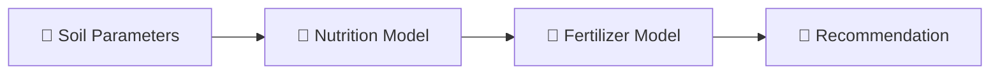

<div align="center">


<b><i>Predict soil fertility and recommend fertilizers</i></b>


      

   
</div>

---

## 🌱 About the Project

Two ML models in one app: the first predicts **soil fertility / nutrition** from soil parameters, and the second **recommends the right fertilizer** based on soil type, crop and nutrient levels. Every prediction is saved in the user's **history**.

## ✨ Key Features

- 🔬 **Soil nutrition** prediction (pH category, season, photoperiod, soil type...)
- 🧪 **Fertilizer recommendation** by soil & crop
- 📜 Per-user prediction **history** (SQLite)
- 🔐 Register / login
- 📓 Separate notebooks for both models

## 🧠 How It Works



## 🛠️ Tech Stack

| Layer | Technology |
|---|---|
| Language | Python 3 |
| Data & ML | Pandas · NumPy · scikit-learn |
| Notebook | Jupyter |
| Web App | Flask + Jinja2 templates |
| Frontend | HTML5 · CSS3 |
| Database | SQLite |

## 📂 Project Structure

```text
SOIL-NUTRITION-PREDICTION/
├── app.py
├── soil nutrition.ipynb · Fertilizer.ipynb
├── Soil Nutrients.csv · Fertilizer Prediction.csv
├── models/ (model.pkl, model1.pkl)
├── encoders/ (le_*.pkl)
├── instance/users.db
└── templates/ (home, nutrition, fertilizer, history, login, register)
```

## 🚀 Getting Started

```bash
git clone https://github.com/PreciousBharath/SOIL-NUTRITION-PREDICTION.git
cd SOIL-NUTRITION-PREDICTION
pip install flask flask-sqlalchemy pandas numpy scikit-learn
python app.py
```

## 🤝 Contributing

Contributions, issues and feature requests are welcome! Feel free to ⭐ star the repo and open a pull request.

## 👨‍💻 Author

<div align="center">

**Bharath** — Software Developer · Project Engineer · Technical Trainer

<a href="https://github.com/PreciousBharath"></a>
<a href="https://linkedin.com/in/connectbharath"></a>

### 🍔 EAT · 💻 CODE · 😴 SLEEP · 🔁 REPEAT

⭐ **If you found this project useful, give it a star!** ⭐


</div>
